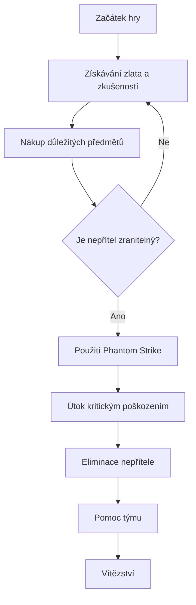

# asas

# 🗡️ Phantom Assassin – Mortred

> „Závoj stínů se zvedá. Čepel je připravena.“

## 🖤 Představení hrdiny

**Phantom Assassin**, známá také jako **Mortred**, je hrdinka ze hry Dota 2.

Je to smrtící nájemná vražedkyně, která se specializuje na likvidaci nepřátelských hrdinů pomocí vysoké rychlosti útoků a obrovského kritického poškození.

*Její nepřátelé ji často ani nestihnou spatřit.*

## 📜 Základní informace

| Vlastnost | Informace |
|---|---|
| Jméno hrdiny | Phantom Assassin |
| Pravé jméno | Mortred |
| Hlavní atribut | Agility |
| Role | Carry |
| Typ útoku | Melee |
| Obtížnost | Střední |
| Hra | Dota 2 |

## ⚔️ Schopnosti

### 1. Stifling Dagger
Phantom Assassin hodí dýku na nepřítele, způsobí mu poškození a zpomalí ho.

### 2. Phantom Strike
Teleportuje se k nepřátelskému nebo spojeneckému hrdinovi a získá zvýšenou rychlost útoků.

### 3. Blur
Zvyšuje její schopnost vyhýbat se fyzickým útokům a ztěžuje nepřátelům její odhalení.

### 4. Coup de Grace
Její ultimátní schopnost. Poskytuje útokům šanci způsobit obrovské kritické poškození.

## 🩸 Herní styl

Phantom Assassin je hrdinka, která se stává silnější během průběhu hry.

Její hlavní strategie:

1. Získávat zlato a zkušenosti.
2. Nakupovat důležité předměty.
3. Vyčkat na správný okamžik k útoku.
4. Eliminovat důležité nepřátelské hrdiny.
5. Pomáhat týmu vyhrát souboje.

*Trpělivost je klíčem k úspěchu každého zabijáka.*

## 🖼️ Vzhled hrdinky


*Phantom Assassin – Mortred, smrtící vražedkyně ze hry Dota 2.*

## 🔗 Užitečné odkazy

- [Oficiální webová stránka Dota 2](https://www.dota2.com/)
- [Phantom Assassin – Dota 2 Wiki](https://dota2.fandom.com/wiki/Phantom_Assassin)
- [Dota 2 na Steamu](https://store.steampowered.com/app/570/Dota_2/)

## 💻 Digitální laboratoř – Python

Jednoduchý program v Pythonu, který simuluje kritický útok Phantom Assassin.

```python
import random

hero = "Phantom Assassin"
base_damage = 100
critical_chance = 0.15
critical_multiplier = 4.5

if random.random() < critical_chance:
    damage = base_damage * critical_multiplier
    print("KRITICKÝ ÚTOK!")
else:
    damage = base_damage

print(hero, "způsobuje", damage, "poškození!")
```

## 📊 Výhody a nevýhody

| Výhody | Nevýhody |
|---|---|
| Vysoké kritické poškození | Slabší začátek hry |
| Vysoká mobilita | Závislost na předmětech |
| Rychlá eliminace nepřátel | Zranitelnost vůči magickému poškození |
| Silná v pozdější fázi hry | Některé předměty ji dokážou účinně zastavit |

## 🎒 Důležité předměty

| Předmět | Využití |
|---|---|
| Battle Fury | Rychlejší získávání zlata |
| Desolator | Vyšší fyzické poškození |
| Black King Bar | Ochrana před mnoha magickými schopnostmi |
| Satanic | Léčení pomocí útoků a přežití |
| Abyssal Blade | Možnost znehybnit nepřítele |

## ✅ Můj seznam úkolů

- [x] Poznat schopnosti hrdinky
- [x] Pochopit její herní styl
- [x] Prozkoumat důležité předměty
- [ ] Zlepšit načasování kritických útoků
- [ ] Zlepšit efektivitu získávání zlata
- [ ] Stát se lepším hráčem na pozici Carry

## 🧮 Matematika – Výpočet poškození

Vypočítejme očekávané poškození kritického útoku.

Vzorec:

$$
D = B \cdot (1-P) + B \cdot M \cdot P
$$

Kde:

- $D$ = očekávané poškození
- $B$ = základní poškození
- $P$ = pravděpodobnost kritického útoku
- $M$ = násobitel kritického poškození

Příklad:

$$
D = 100 \cdot 0.85 + 100 \cdot 4.5 \cdot 0.15
$$

$$
D = 85 + 67.5 = 152.5
$$

**Očekávané poškození: 152,5**

*Jedná se o zjednodušený matematický příklad, nikoliv o přesný výpočet aktuálních herních mechanismů.*

## 🔄 Strategie Phantom Assassin



## 🌑 Závěr

Phantom Assassin je jednou z nejznámějších hrdinek ve hře Dota 2.

Její největší předností je **mobilita, kritické poškození a schopnost eliminovat nepřátele během několika sekund**.

Odměňuje hráče, kteří vědí, kdy zaútočit a kdy raději počkat.

*Jeden úder může rozhodnout o všem.*
